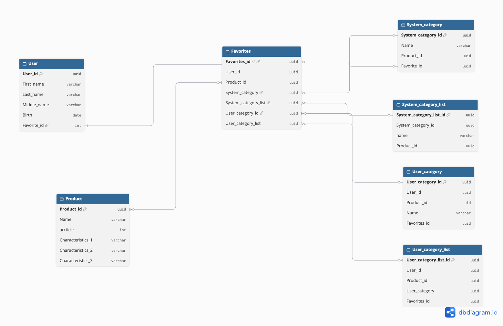
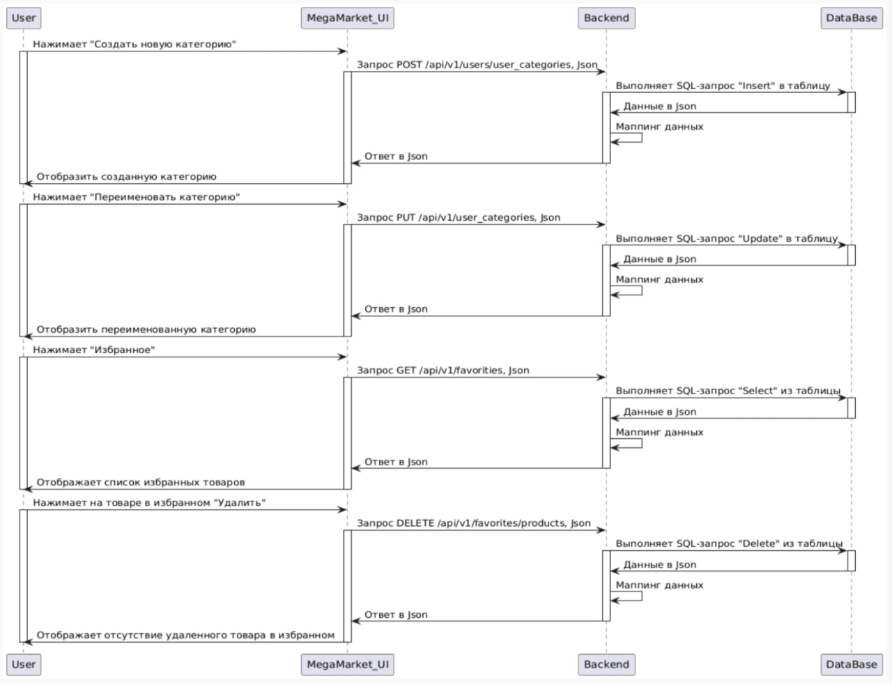
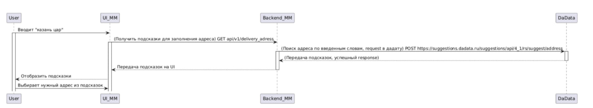

= Техническое задание на разработку новой функциональности "Избранное" (Wishlist) интернет магазина "МегаМаркет"

[cols="1,1,2,3", options="header"]
|====
|Версия|Дата|Автор|Описание изменений

|1.0
|15.10.2026
|Власова С.Б.
|Создан документ

|====

== 1. Введение
=== 1.1 Цель документа
Настоящий документ определяет функциональные и технические требования к разработке избранного (Wishlist) для интернет-магазина "МегаМаркет" (далее - система).
Система предназначена для  оформления заказов, создания пользовательских категорий, повышения LTV клиента за счет персонализации и удержания, а также уведомления клиента о снижении цены.

=== 1.2 Область применения
Система используется покупателями интернет-магазина для оформления заказов, добавления товаров в избранное; продавцами - для управления ассортиментом и отслеживания статистики; а также администраторами - для управления системой

=== 1.3 Определения и сокращения

|===

|Термин|Определение
|Заказ| это....
|LTV| это....

|===

== 2. Функциональные и нефункциональные требования

[options="header"]
|===
|Группа требований|Описание
.19+|Функциональные
| У пользователя должна быть возможность добавлять товар в избранное
| У пользователя должна быть возможность удалять товар из избранного
| У пользователя должна быть возможность добавлять товар из избранного в корзину
| Кнопка добавления товара в избранное должна быть в форме сердца или звезды
| При нажатии на кнопку "В избранное"  система должна добавлять товар в избранное пользователя
| Избранное должно располагаться в отдельном разделе
| Товары в разделе "Избранное" должны по умолчанию отображаться в виде полноценных карточек 1 в 1 как в основном каталоге
| У пользователя должна быть возможность сортировки избранного: от нового к старому
| У пользователя должна быть возможность поиска товара по наименованию в избранном по полному/неполному совпадению
| При поиске товара в избранном система должна отображать всплывающую подсказку с наименованием подходящего товара
| Поиск по избранному должен осуществлять по мере ввода
| У пользователя должна быть возможность создания пользовательской категории
| При добавлении товара в избранное система должна предлагать соответствующую ему системную категорию
| Интерфейс должен быть адаптирован под мобильное приложение, приложение для планшетов
| Обеспечить доступность добавления товаров в избранное только зарегистрированным и авторизованным пользователям
| Систем должна перенаправлять незарегистрированного/неавторизованного пользователя, который пытается добавить товар в избранное на экран регистрации/авторизации
|В избранном должна быть возможность настройки количества отображаемых товаров: 10, 50, 100
|В избранном должно быть ограничение на максимальное количество отображаемых товаров: не более 150
|При достижении максимального количества товаров в избранном, система должна предложить пользователю удалить старые позиции
.7+|Нефункциональные
|Система должна работать в штатном режиме без сбоев и падений при одновременном использовании 2,5 млн пользователь в сутки
|Система должна восстанавливаться после падения не более 5 минут
|Экран со списком избранного должен открываться не более 0,5 секунд
|В качестве примера UI/UX/категорий/делиться избранным использовать площадку OZON
|Система должна выдерживать количество пользователей в четыре раза большее среднего их значения в сутки  в период с 19:00 до 23:00, работать без сбоев и падений
|Система должна хранить данные не менее 5 лет
|Ежедневный прирост данных должен быть не более 10ГБ
|===

== 3. Требования к Backend
=== 3.1 ER-диаграмма

=== 3.2 Описание базы данных
Таблица `products`.
Хранит информацию о товарах онлайн магазина.
[options="header"]
|=====
|Наименование атрибута|Наименование в БД|Тип данных|Обязательность|Примечание
|Уникальный идентификатор товара|id|uuid|Да|PK
|Наименование твара|name|varchar(255)|Да|
|Артикул товара|article|varchar(50)|Нет|
|Старана-производитель|country|varchar(50)|Да|
|Наименование бренда|name_brand|varchar(255)|Нет|
|=====

Таблица `favorites`.
Храните информацию о товарах, которые пользователь добавил в избранное.

[options="header"]
|=====
|Наименование атрибута|Наименование в БД|Тип данных|Обязательность|Примечание
|Идентификатор Избранного|id|uuid|Да|PK
|Идентификатор пользователя|user_id|uuid|Нет|FK
|Идентификатор товара|product_id|uuid|Нет|FK
|Идентификатор системной категории|system_category_id|uuid|Нет|FK
|Идентификатор пользовательской категории|user_category_id|uuid|Нет|FK
|=====

. *id* (уникальный идентификатор избранного) привязывается к конкретному пользователю;
. *user_id* (идентификатор пользователя) ссылается на таблицу `users`;
. *product_id* (идентификатор товара) ссылается на таблицу `products`;
. *system_category_id* (идентификатор системной категории) ссылается на таблицу `system_categories` - справочник, где хранятся все системные категории, к которым принадлежат товары по умолчанию;
. *user_category_id* (идентификатор пользовательской категории) ссылается на таблицу `user_categories` - таблица, где хранятся все пользовательские категории, которые привязаны к конкретному пользователю).

== 4 Описание  API-запросов
=== 4.1 Внутренние API-запросы
=== 4.1.1 API-эндпоинты
[options="header"]
|====
|Описание|Метод|Эндпоинт|Доступ
|Создать новую системную категорию|POST|/api/v1/system_categories|Для администратора
|Создать новую пользовательскую категорию|POST|/api/v1/user_categories|Для зарегистрированного пользователя
|Добавить товар в избранное|POST|/api/v1/favorites| Для зарегистрированного пользователя
|Получить список избранного|GET|/api/v1/favorites|Для зарегистрированного пользователя
|Получить товары в определенной категории|GET|/api/v1/favorites/user_categories/{id}| Для зарегистрированного пользователя
|Убрать товар из избранного|DELETE|/api/v1/favorites/{id}|Для зарегистрированного пользователя
|Переименовать категорию|PUT|/api/v1/user_categories|Для зарегистрированного пользователя
|Получить список всех пользовательских категорий|GET|/api/v1/user_categories|Для зарегистрированного пользователя
|Получить информацию о категории|GET|/api/v1/system_categories/{id}|Для зарегистрированного пользователя
|Удалить свою категорию|DELETE|/api/v1/user_categories/{id}|Для зарегистрированного пользователя
|Отфильтровать список избранного по цене|GET|/api/v1/favorities?min_price=5000&max_price=10000|Для зарегистрированного пользователя
|Отсортировать список избранного по цене|GET| api/v1/favorities?sort=priceAsc|Для зарегистрированного пользователя
|====
=== 4.1.2 Sequence-диаграмма

=== 4.1.3  POST /api/v1/user_categories

**Описание:**
Создает новую пользовательскую категорию. Используется покупателями для привязки товаров к созданной категории

**URL:**
`/api/v1/user_categories`

**Метод:**
`POST`

**Аутентификация:**
Требуется JWT-токен в заголовке `Authorization: Bearer <token>`

==== Тело запроса

[options="header"]
|=====
|Параметр|Тип данных|Обязательность|Комментарий
|user_id|int|да| Идентификатор пользователя
|name|varchar|да| Наименование пользовательской категории
|=====

**Пример запроса:**

[source, json]
----
include::api/request.json[]

----

==== Параметры ответа

[options='header']
|====
| Параметр | Тип данных | Обязательность | Комментарий
|id|uuid|да|Идентификатор созданной категории
|====

**Пример ответа:**

Избранные товары найдены
[source, json]
----
include::api/response.json[]
----

Избранные товары не найдены
[source, json]
----
include::api/2_response.json[]
----

**Логика работы:**

===== Логика работы
. *Проверка тела запроса*
* Сервер проверяет тело запроса на валидность.
* Если тело запроса невалидно, возвращается ошибка 400

. *Проверка user_id*
* Если пользователь с указанным `user_id` не найден, возвращается ошибка 404

. *Создание новой записи*
* Сервер создает новую запись в таблице user_categories

. *Формирование ответа*
* При успешном создании записи сервер возвращает идентификатор созданной записи и код ответа 201
* В случае непредвиденной ошибки сервер возвращает ошибку 500.

=== 4.2 Внешние запросы

==== 4.2.1  Интеграция с внешней системой DaData
Интеграционный метод “Подсказки по адресам” в системе “DaData” предназначен для поиска адреса по любой его части от региона до квартиры, в том числе по почтовому индексу.
Метод будет использоваться в приложении “МегаМаркет” для отображения подсказки при вводе пользователем адреса перед оформлением доставки.

==== 4.2.2 Sequence-диаграмма

==== 4.2.3 POST /suggest/address - подскази по адресам

**Описание:**
Отображение подсказки при вводе пользователем адреса перед оформлением доставки.

**API-документация внешней системы:**
`https://dadata.ru/api/suggest/address/`

**URL:**
`https://suggestions.dadata.ru/suggestions/api/4_1/rs/suggest/address`

**Метод:**
`POST`

**Аутентификация:**
Для аутентификации используется api-ключ DaData, который передается в HTTP-заголовке Authorization в следующем формате: `Authorization : Token api-key`

**Заголовки запроса:**

[options="header"]
|===
|Заголовок|Обязательность|Значение по умолчанию|Описание
|Content-Type|Да|application/json| Тип содержимого запроса
|Accept|Да|application/json|Принимаемые форматы ответа
|Authorization|Да|Token <Api Key>| Апи-ключ для авторизации
|===

**Пример запроса:**

[source, json]
----
{ "query": "казань цар" }
----

**Пример успешного ответа:**

[source, json]
----
{
   "suggestions": [
       {
           "value": "Нижегородская обл, г Саров, ул Маяковского, д 17, кв 73",
           "unrestricted_value": "607185, Нижегородская обл, г Саров, ул Маяковского, д 17, кв 73",
           "data": {
               "postal_code": "607185",
               "country": "Россия",
               "country_iso_code": "RU",
               "federal_district": "Приволжский",
               "region_fias_id": "88cd27e2-6a8a-4421-9718-719a28a0a088",
               "region_kladr_id": "5200000000000",
               "region_iso_code": "RU-NIZ",
               "region_with_type": "Нижегородская обл",
               "region_type": "обл",
               "region_type_full": "область",
               "region": "Нижегородская",
               "area_fias_id": null,
               "area_kladr_id": null,
               "area_with_type": null,
               "area_type": null,
               "area_type_full": null,
               "area": null,
               "city_fias_id": "be0210d1-1b58-49c1-8304-eb5ff5618fad",
               "city_kladr_id": "5200000300000",
               "city_with_type": "г Саров",
               "city_type": "г",
               "city_type_full": "город",
               "city": "Саров",
               "city_area": null,
               "city_district_fias_id": null,
               "city_district_kladr_id": null,
               "city_district_with_type": null,
               "city_district_type": null,
               "city_district_type_full": null,
               "city_district": null,
               "settlement_fias_id": null,
               "settlement_kladr_id": null,
               "settlement_with_type": null,
               "settlement_type": null,
               "settlement_type_full": null,
               "settlement": null,
               "street_fias_id": "8c7aa986-8062-403b-b396-c831e0c2b0f8",
               "street_kladr_id": "52000003000004400",
               "street_with_type": "ул Маяковского",
               "street_type": "ул",
               "street_type_full": "улица",
               "street": "Маяковского",
               "stead_fias_id": null,
               "stead_cadnum": null,
               "stead_type": null,
               "stead_type_full": null,
               "stead": null,
               "house_fias_id": "f251e7d5-9b89-49ec-bebe-9fe1a0fd2ae4",
               "house_kladr_id": "5200000300000440007",
               "house_cadnum": null,
               "house_flat_count": null,
               "house_type": "д",
               "house_type_full": "дом",
               "house": "17",
               "block_type": null,
               "block_type_full": null,
               "block": null,
               "entrance": null,
               "floor": null,
               "flat_fias_id": "581c5929-b7f8-4f97-b02d-7afa1df08199",
               "flat_cadnum": null,
               "flat_type": "кв",
               "flat_type_full": "квартира",
               "flat": "73",
               "flat_area": null,
               "square_meter_price": null,
               "flat_price": null,
               "room_fias_id": null,
               "room_cadnum": null,
               "room_type": null,
               "room_type_full": null,
               "room": null,
               "postal_box": null,
               "fias_id": "581c5929-b7f8-4f97-b02d-7afa1df08199",
               "fias_code": null,
               "fias_level": "9",
               "fias_actuality_state": "0",
               "kladr_id": "5200000300000440007",
               "geoname_id": "498525",
               "capital_marker": "0",
               "okato": "22503000000",
               "oktmo": "22704000001",
               "tax_office": "5252",
               "tax_office_legal": "5252",
               "timezone": null,
               "geo_lat": "54.942493",
               "geo_lon": "43.3145222",
               "beltway_hit": null,
               "beltway_distance": null,
               "metro": null,
               "divisions": null,
               "qc_geo": "0",
               "qc_complete": null,
               "qc_house": null,
               "history_values": null,
               "unparsed_parts": null,
               "source": null,
               "qc": null
           }
       }
   ]
}

----

**Пример ошибки:**

Выбран некорректный тип авторизации
[source, json]
----
{
   "family": "CLIENT_ERROR",
   "reason": "Unauthorized",
   "message": "You should provide Authorization header with your api token"
}
----

**Маппинг данных:**

[options="header"]
|=====
|Параметр| В API MegaMarket|Обязательность|В API DaData| Комментарий
|Адрес всей строкой|fullAddress|Да|suggestions[].value|Максимальное кол-во символов
|Регион|region|Да|suggestions[].data.region_with_type|Регион с типом:
“Нижегородская обл.”
|Город|sity|Да|suggestions[].data.city_with_type|Город с типом
“г. Казань”
|Улица|street|Да|suggestions[].data.street_with_type|Улица с типом “ул. Царская”
|Дом|house|Да|suggestions[].data.house|Дом с типом “д.23”
|Квартира|flat|Нет|suggestions[].data.flat|Квартира с типом “кв. 27”
|Индекс|postal_code|Нет|suggestions[].data.postal_code|Может отсутствовать
|=====

== 5 Архитектура

=== 5.1 Схема архитектуры - С4/ Container
image::image/c4-2.drawio.svg[]

=== 5.2 Описание элементов архитектуры

[options="header"]
|===
|Сервис|Технология|Назначение
|Сервис Заказов|По согласованию с арх. и командой| Формирование, изменение, отмена заказов
|Сервис Платежей|По согласованию с арх. и командой| Оплата заказов
|Сервис возвратов|По согласованию с арх. и командой|Работа с возвратом заказов
|Сервис администрирования|По согласованию с арх. и командой|Управление системой
|Сервис доставки|По согласованию с арх. и командой|Логистика доставки
|Сервис уведомлений|По согласованию с арх. и командой|Уведомляет пользователей об акциях, изменении цен, наличии товаров
|Сервис рекомендаций|По согласованию с арх. и командой| Читает сообщения о действиях покупателя, подписка на журнал сообщений брокера Кафки
|Брокер сообщений|Предварительно Apache Kafka|сбор всех событий, касающихся действий пользователя с избранными товарами
|Сервис избранного|По согласованию с арх. и командой|Добавление, удаление, изменение кол-ва товара из избранного. Отправляет сообщения о действиях покупателя брокеру сообщений
|===

**Примечания к архитектуре:**
Если требуется именно отправление уведомлений пользователям, то pull-модель Кафки не подойдет, для этих целей подойдет Rabbit с push-моделью

